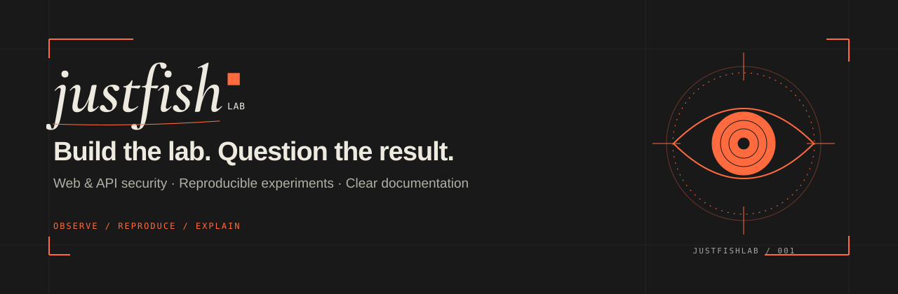

<a href="https://justfishlab.my.id"><strong>Portfolio</strong></a> / <a href="https://justfishlab.my.id/notes">Jurnal lab</a> / <a href="https://github.com/justfishlab2/security-labs">Source & tes</a> / <a href="https://hackerone.com/justfish">HackerOne</a>

<a href="README.md">English</a> · Bahasa Indonesia

# Justfish / JustFishLab

Saya Justfish. Saya sedang membangun praktik riset keamanan web dan API melalui eksperimen terkontrol, dokumentasi yang jelas, dan pengujian yang dapat diulang.

**Profil ini merupakan catatan kerja, bukan daftar pencapaian buatan.** Fokusnya memperlihatkan pertanyaan, metode, perilaku yang diamati, dan batas kesimpulan—bukan sekadar menempelkan nama kerentanan pada screenshot.

> Amati batasnya. Reproduksi perilakunya. Jelaskan perubahannya.

## 01 / Fokus saat ini

| Fokus | Pertanyaan yang ingin dipahami |
| :--- | :--- |
| **Otorisasi objek** | Apakah akun yang sedang mengakses memang berhak atas objek tersebut, bukan sekadar sudah login? |
| **Perilaku web & API** | Bagaimana identitas, request, kepemilikan data, dan respons saling memengaruhi? |
| **Bukti yang dapat diulang** | Bagaimana eksperimen dibuat jelas dan dapat diuji tanpa mengungkap data orang lain? |
| **Penulisan teknis** | Bagaimana membedakan observasi, interpretasi, perbaikan, dan pertanyaan yang belum terjawab? |

## 02 / Pekerjaan pilihan

### [Security labs →](https://github.com/justfishlab2/security-labs)

Eksperimen di lingkungan milik sendiri, dengan data sintetis, source yang bisa dijalankan, dan tes regresi.

**Lab 001 — Kontrol akses objek**

Dua akun simulasi dan satu catatan sintetis. Request lintas akun dibandingkan sebelum dan setelah pemeriksaan pemilik.

| Request | Tanpa pemeriksaan pemilik | Dengan pemeriksaan pemilik |
| :--- | :---: | :---: |
| Akun A → catatan A | `200` | `200` |
| Akun B → catatan A | `200` | `403` |

[Baca studi kasus](https://justfishlab.my.id/notes/access-control-lab) · [Lihat implementasi](https://github.com/justfishlab2/security-labs/tree/main/labs/001-object-authorization) · [Lihat pengujian](https://github.com/justfishlab2/security-labs/actions/workflows/tests.yml)

Ini lab pembelajaran lokal yang sengaja memuat contoh rentan. Bukan temuan pada target publik, penghargaan bounty, atau bukti keamanan seluruh aplikasi.

### [Portfolio JustFishLab →](https://justfishlab.my.id)

Rumah multibahasa untuk jurnal lab dan identitas visual personal. Dibangun dengan React dan Vite, dengan perhatian pada layout responsif, keterbacaan, dan konsistensi visual.

Portfolio menjelaskan pekerjaannya; repository membuat bagian teknisnya bisa diperiksa.

## 03 / Cara kerja

1. **Tentukan batas.** Jelaskan akun, objek, peran, atau tenant yang seharusnya boleh melakukan suatu tindakan.
2. **Buat perbandingan terkontrol.** Ubah satu aktor atau keputusan otorisasi dengan resource yang tetap jelas.
3. **Catat hasil.** Simpan request, hasil yang diharapkan, respons aktual, dan asumsi lingkungan bersama-sama.
4. **Terapkan perbaikan relevan.** Jelaskan pemeriksaannya, bukan menganggap satu patch menyelesaikan semua masalah.
5. **Tambahkan tes regresi.** Periksa akses terlarang dan akses sah yang harus tetap berfungsi.
6. **Tuliskan batasnya.** Tes kecil yang lulus hanya mendukung kesimpulan yang spesifik.

## 04 / Peralatan pada pekerjaan saat ini

**Implementasi lab** · JavaScript, Node.js, HTTP/JSON, `node:test`  
**Portfolio** · React, Vite, CSS/SVG  
**Alur kerja** · Git, GitHub Actions, Markdown, Linux

Daftar ini mencerminkan alat yang digunakan pada pekerjaan yang dipublikasikan, bukan klaim keahlian menyeluruh.

## 05 / Batas riset

- Hanya lab milik sendiri atau target dengan izin eksplisit.
- Demonstrasi publik memakai data sintetis.
- Tidak mengunggah kredensial, data privat target, catatan pengunjung, atau detail kerentanan yang belum diizinkan.
- Tidak membuat-buat CVE, total bounty, peringkat, proyek klien, atau sertifikasi.
- Pelaporan riset nyata mengikuti kebijakan resmi target.

## 06 / Rencana, bukan hasil yang sudah diklaim

- [ ] Memperluas lab lokal untuk isolasi tenant dan matriks peran sederhana.
- [ ] Menambah eksperimen setelah benar-benar diuji.
- [ ] Menghubungkan setiap artikel ke implementasi dan tes regresi yang sesuai.

## Kontak

Untuk komunikasi profesional atau proyek: **[hello@justfishlab.my.id](mailto:hello@justfishlab.my.id)**.  
Issue repository digunakan untuk koreksi non-sensitif. Jangan kirim secret atau detail kerentanan privat melalui issue publik.

---

JustFishLab · Tetap ingin tahu. Hormati izin. Simpan buktinya.
