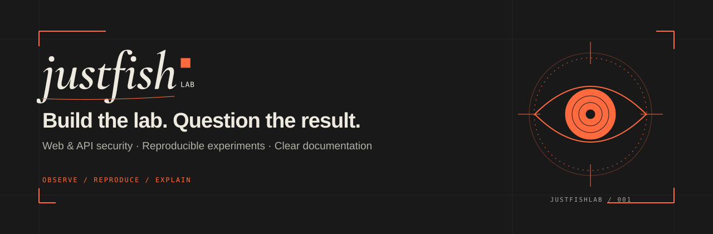

  

  <a href="https://justfishlab.my.id"><strong>Portfolio</strong></a> &nbsp; / &nbsp;
  <a href="https://justfishlab.my.id/notes">Lab journal</a> &nbsp; / &nbsp;
  <a href="https://github.com/justfishlab2/security-labs">Source & tests</a> &nbsp; / &nbsp;
  <a href="https://hackerone.com/justfish">HackerOne</a>

English · <a href="README.id.md">Bahasa Indonesia</a>

# Justfish / JustFishLab

I’m Justfish. I’m building an independent practice in web and API security through controlled experiments, careful documentation, and repeatable tests.

**This profile is a working record, not a highlight reel.** The goal is to show the question, the test, the observed behavior, and the limits of the conclusion—not simply attach a vulnerability name to a screenshot.

> Observe the boundary. Reproduce the behavior. Explain what changed.

## 01 / What I’m working on

| Focus | What I want to understand |
| :--- | :--- |
| **Object-level authorization** | Whether the current actor is allowed to access this specific object—not merely whether they are logged in. |
| **Web & API behavior** | How identity, request handling, resource ownership, and response behavior interact. |
| **Reproducible evidence** | How to make a finding understandable, rerunnable, and testable without exposing someone else’s data. |
| **Clear technical writing** | How to distinguish an observation, an interpretation, a remediation, and an unanswered question. |

## 02 / Featured work

### [Security labs →](https://github.com/justfishlab2/security-labs)

Small, owned-environment experiments with synthetic data, runnable source, and regression tests.

**Lab 001 — Object-level authorization**

Two simulated accounts. One synthetic note. The same cross-account request, before and after an ownership check.

| Request | Without an owner check | With an owner check |
| :--- | :---: | :---: |
| Account A → A’s note | `200` | `200` |
| Account B → A’s note | `200` | `403` |

[Read the case study](https://justfishlab.my.id/notes/access-control-lab) · [Inspect the implementation](https://github.com/justfishlab2/security-labs/tree/main/labs/001-object-authorization) · [View test runs](https://github.com/justfishlab2/security-labs/actions/workflows/tests.yml)

This is a deliberately vulnerable local teaching lab, not a public-target vulnerability report, a bounty award, or proof that an entire application is secure.

### [JustFishLab portfolio →](https://justfishlab.my.id)

A multilingual home for lab notes and personal visual identity. Built with React and Vite, with an emphasis on responsive layout, readable documentation, and a consistent editorial system.

The site explains the work; the repositories make the technical parts inspectable.

## 03 / How I approach a lab

1. **Define the boundary.** State which account, object, role, or tenant should be allowed to do what.
2. **Make one controlled comparison.** Change the actor or authorization decision while keeping the resource understandable.
3. **Record the result.** Keep the request, expected behavior, actual response, and environment assumptions together.
4. **Apply the smallest relevant fix.** Explain the check rather than presenting a patch as a universal solution.
5. **Keep a regression test.** Verify both the denied cross-account request and the legitimate request that must still work.
6. **Document what remains unknown.** A small passing test is evidence for a narrow behavior, not a blanket security claim.

## 04 / Tools in the current work

**Lab implementation** · JavaScript, Node.js, HTTP/JSON, `node:test`  
**Portfolio** · React, Vite, CSS/SVG  
**Workflow** · Git, GitHub Actions, Markdown, Linux

These are tools used in the published work—not an exhaustive skills inventory or a claim of expertise in every part of the stack.

## 05 / Research boundaries

- Only owned labs or explicitly authorized targets.
- Synthetic data for public demonstrations.
- No public upload of credentials, private target data, visitor records, or unapproved vulnerability details.
- No manufactured CVEs, bounty totals, rankings, client work, or certifications.
- Responsible reporting through the target’s published policy when real research is in scope.

## 06 / Next, not yet claimed

- [ ] Extend the local lab to cover tenant isolation and a small role matrix.
- [ ] Add another documented experiment when it is actually tested.
- [ ] Connect each published case study to the exact implementation and regression test.

## Contact

For professional or project-related messages: **[hello@justfishlab.my.id](mailto:hello@justfishlab.my.id)**.  
For this repository: use an issue for non-sensitive corrections. Please do not post secrets or private vulnerability details in public issues.

---

JustFishLab · Stay curious. Respect the scope. Keep the evidence.
